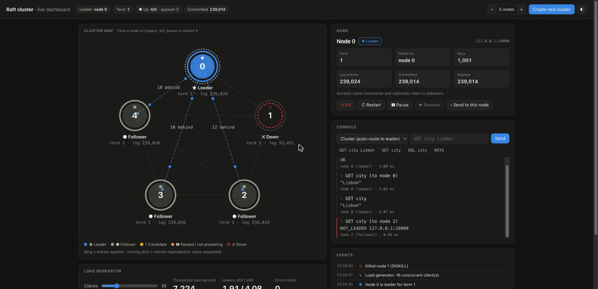

# Fault-Tolerant Distributed Key-Value Store

This project is a from-scratch implementation of a fault-tolerant, distributed key-value store in C++. It is designed to be highly available and resilient to node failures, achieving data consistency across a replicated cluster via the Raft consensus algorithm. It is conceptually similar to core infrastructure components like Redis or etcd.


<sub>A real, unedited session with the [interactive dashboard](#-interactive-dashboard) on a 5-node cluster ([MP4](docs/demo.mp4) · [click-through tour](https://davenc.dev/resources/other/kv-store-tour.html) · [how it's recorded](docs/DEMO.md)).</sub>

---

## 🚀 Features

-   **Distributed Consensus**: Uses the Raft algorithm for leader election and replicated log management to ensure data consistency.
-   **Fault Tolerance**: The cluster can tolerate failures of minority nodes and continue to serve requests.
-   **Automated Cluster Launching**: Includes a powerful script to build, clean, and launch a multi-node cluster in separate, customizable terminal windows.
-   **Persistence**: Each node keeps its key/value state in an Append-Only File (AOF) and its Raft term, vote and log in a separate fsync'd state file (`AOFs/node_<id>.raft`), written by one background thread in batches (group commit) so a slow disk never stalls heartbeats or replication. A restarted node keeps its promises (at most one vote per term) and only re-fetches entries it is missing. On macOS `fsync` does not flush the drive's own cache, so this protects against process crashes but not necessarily power loss.
-   **Concurrent & Asynchronous Networking**: Built on a multi-threaded, event-driven server architecture using Boost.Asio to handle many simultaneous client connections efficiently.
-   **Modern C++**: Utilizes C++20 features, including concurrency primitives and coroutines for clean, modern asynchronous code.
-   **Low-Latency Replication**: New entries are replicated as soon as they arrive (not on the next heartbeat), batched with one in-flight request per follower over reused TCP connections. On a local 3-node cluster the median write takes about 0.2 ms, and 64 clients sustain over 26,000 ops/s (p99 4.6 ms).
-   **Fast Follower Recovery**: Followers report where their log diverges, so a restarted node that missed tens of thousands of writes catches up in under 0.2 s.
-   **Verified by a Fault-Injection Harness**: A reproducible benchmark suite kills leaders under load and checks durability, replica convergence, and quorum safety on every run (see [Benchmarks](#-benchmarks--fault-injection)).

---

## 🎬 Live Demo

The recording at the top of this README is the [interactive dashboard](#-interactive-dashboard),
driven by a Playwright script against a real cluster; [docs/DEMO.md](docs/DEMO.md) explains how to
re-record it.

There's also a narrated terminal walkthrough. Once the project builds (see
[Build Instructions](#️-build-instructions)), one command launches a real 5-node cluster on
localhost and walks through it in about a minute:

```bash
python3 bench/demo.py            # add --pace 0 to skip the pauses, --nodes 3 for a smaller cluster
```

| Step | What you see |
|---|---|
| 1. Leader election | Nodes campaign and a leader is elected (~350 ms) |
| 2. Client redirection | A follower answers `NOT_LEADER <addr>`; the client follows it to the leader |
| 3. Replication | A committed write appears in every node's AOF |
| 4. Throughput | Live ops/s bar for 32 concurrent clients, then p50/p99 latency |
| 5. Leader crash under load | Leader `SIGKILL`ed mid-write; new leader in ~350 ms; audit finds zero lost acknowledged writes |
| 6. Minority failure | With 2 of 5 nodes down, writes still commit |
| 7. Losing quorum safely | With 3 of 5 down, the leader refuses to acknowledge writes |
| 8. Recovery | Crashed nodes restart, quorum returns, and all replicas converge to identical state |

A recording of it is in [docs/terminal-demo.gif](docs/terminal-demo.gif)
([MP4](docs/terminal-demo.mp4) · [asciinema](docs/terminal-demo.cast)). To regenerate it (requires
`asciinema`, `agg` and `ffmpeg`), run `./docs/record-terminal-demo.sh`; it refuses to render a run
in which any guarantee was violated.

The demo exits non-zero if any guarantee is violated, so it doubles as an end-to-end smoke test.

---

## 🕹 Interactive Dashboard

A local web UI for poking at a real cluster:

```bash
python3 dashboard/server.py        # builds the server and opens http://localhost:8090
```

### Running the dashboard

1.  **Requirements**: Python 3.10+ (standard library only, no `pip install`) plus the C++ toolchain
    from [Prerequisites](#-prerequisites). The dashboard is a single static page served by
    `dashboard/server.py`; there is no frontend build step.
2.  **Point it at vcpkg** so it can build the server. It uses the first of: `CMAKE_TOOLCHAIN_FILE`,
    `$VCPKG_ROOT/scripts/buildsystems/vcpkg.cmake`, or the toolchain recorded in an existing
    `build/CMakeCache.txt` (so if you've already followed [Build Instructions](#️-build-instructions),
    nothing else is needed):
    ```bash
    export VCPKG_ROOT=~/vcpkg
    ```
3.  **Start it** from the repository root. The first run compiles a Release build of `server` into
    `bench/.cache/`; later runs reuse it.
    ```bash
    python3 dashboard/server.py                          # 5 nodes, http://localhost:8090
    python3 dashboard/server.py --nodes 3 --port 9000    # different cluster size / UI port
    python3 dashboard/server.py --bin build/server       # skip the build, use your own binary
    python3 dashboard/server.py --no-browser             # don't open a tab (e.g. over SSH)
    ```
    Servers listen on ports 20000 and up (`--base-port` to change). Each run uses a fresh temporary
    directory for AOFs and Raft state, so it never touches `build/AOFs`.
4.  **Stop it** with Ctrl-C; every node it started is killed and its temporary directory removed.



-   **Cluster map**: every node is a dot, coloured and labelled by role (leader, follower, candidate, paused, down), with its term, log length and an applied-entries ring. The leader's link to each follower shows how many entries that follower is behind, and moving dots show entries being replicated and votes being requested, derived from each node's real state.
-   **Node controls**: click a node to kill it (`SIGKILL`), restart it, or pause/resume it (`SIGSTOP`/`SIGCONT`, a hung server that keeps its sockets open). Rebuild the cluster with 1–7 nodes.
-   **Console**: send `SET`/`GET`/`DEL`/`KEYS` to the cluster (auto-routed to the leader, with any redirects shown) or to one specific node to see `NOT_LEADER` replies.
-   **Load generator**: up to 64 closed-loop clients with a live throughput chart and p50/p99 latency, so you can watch what a leader crash does to traffic.
-   **Event log**: elections, leader changes, kills, restarts and pauses as they happen.

Nodes report their state through a `STATUS` command that each server answers locally (it is not replicated). Raft's peer list is fixed at startup, so changing the cluster size rebuilds the cluster rather than adding a node to a running one.

---

## 🏗 Architecture Overview

The system is built as a cluster of identical server nodes. At any given time, one node is elected as the **Leader**, and all others are **Followers**.

-   **Client Interaction**: All client write requests (`SET`, `DEL`) are directed to the Leader. If a client contacts a Follower, the Follower will redirect the client to the current Leader.
-   **Log Replication**: The Leader appends the command to its own log and immediately sends it to its Followers. Each Follower has at most one `AppendEntries` in flight; entries that arrive meanwhile are sent together as soon as the previous response returns. Heartbeats (every 150 ms) keep idle Followers from starting elections. RPC connections to each peer are pooled and reused.
-   **Log Repair**: If a Follower's log doesn't match, it replies with the index where it diverges, and the Leader retries from there immediately instead of stepping back one entry at a time. Followers only truncate their log at a genuine conflict, so a delayed, out-of-order RPC can't remove entries.
-   **Commit & Apply**: Once a majority of nodes have acknowledged the entry, the Leader "commits" it. Only then is the command applied to the in-memory key-value store (the "state machine"), and the result is returned to the client.
-   **Leader Failure**: If the Leader crashes, the remaining nodes will time out, start a new election, and elect a new Leader from among themselves, ensuring service continuity.

---

## 🛠 Tech Stack

-   **Language**: C++20
-   **Networking**: Boost.Asio (using C++20 coroutines for asynchronous operations)
-   **Concurrency**: Standard C++ library (`std::thread`, `std::mutex`, `std::condition_variable`)
-   **Build System**: CMake
-   **Dependency Management**: Vcpkg

---

## 🔧 Prerequisites

-   A C++ compiler that supports **C++20** (e.g., modern versions of Clang, GCC, or MSVC).
-   **CMake** (version 3.15 or newer).
-   **Vcpkg**: This project uses the Vcpkg package manager to handle the Boost dependency. See the official Vcpkg guide for installation.
-   A build tool like **Ninja** or **make**. (Ninja is recommended.)

---

## ⚙️ Build Instructions

### Clone the Repository:

```bash
git clone https://github.com/daven-c/Fault-Tolerant-KV-Store.git
cd Fault-Tolerant-KV-Store
```

### Install Dependencies with Vcpkg:

```bash
# Make sure you have bootstrapped vcpkg first!
vcpkg install boost
```

### Configure and Build the Project:

```bash
mkdir build
cd build
cmake .. -DCMAKE_TOOLCHAIN_FILE=<path-to-your-vcpkg-dir>/scripts/buildsystems/vcpkg.cmake
cmake --build .
```

This will compile and create the **server** executable inside the `build` directory.

---

## ▶️ Usage

### Running the Distributed Server Cluster

The easiest way to run a cluster is with the included **`launch.sh`** script.
This script automatically handles cleanup, builds the peer list, and launches each server in a separate terminal window for easy monitoring.

#### 1. Make the Script Executable

(This only needs to be done once.)

```bash
chmod +x launch.sh
```

#### 2. Launch the Cluster

To launch a default **3-node cluster**:

```bash
./launch.sh start 3
```

To launch a cluster with a specific number of nodes (e.g., 5):

```bash
./launch.sh start [num]
```

To launch a cluster in the background:

```bash
./launch.sh start-bg [num]
```

#### (Optional). Manually launch the Cluster

To launch clusters manually for 3 clusters:

```bash
./server 0 127.0.0.1:8000 127.0.0.1:8001 127.0.0.1:8002
```

```bash
./server 1 127.0.0.1:8000 127.0.0.1:8001 127.0.0.1:8002
```

```bash
./server 2 127.0.0.1:8000 127.0.0.1:8001 127.0.0.1:8002
```

General Command:

```bash
./server <idx of address (node id)> <list of addresses>
```

After a few seconds, an election will occur, and one node will become the Leader. The other nodes will become Followers and print messages indicating who the Leader is.

Logs for all nodes will be stored in server_logs/ by default

#### 3. Interacting with the Cluster

You can connect to any node in the cluster with a tool like `netcat` to send commands.
If you connect to a follower, it will automatically tell you the address of the current Leader.

```bash
# Connect to any node (e.g., the first one on port 8000)
nc 127.0.0.1 8000

# Send commands
SET name Test
GET name
KEYS
```

You can also restart any node in the cluster with:

```bash
./launch.sh restart <id> <total>
```

_id_ is the id of the node (e.g. 1, 2, 3) and _total_ is the total nodes in the cluster

#### 4. Stopping the Cluster

You can stop the cluster by running the following:

```bash
./launch.sh stop
```

#### 5. Resetting Logs

You can remove all logs from AOFs/ and server_logs/ by running:

```bash
./launch.sh reset
```

---

## 📊 Benchmarks & Fault Injection

`bench/harness.py` builds the server, runs real multi-process clusters, kills leaders and
followers under load, and checks correctness on every run. Results are saved to
`bench/results/` along with the commit and the exact command, so every number can be regenerated.

```bash
python3 bench/harness.py run                     # full run (~3 min)
python3 bench/harness.py run --ref <commit>      # benchmark any older commit
python3 bench/harness.py compare bench/results/baseline-bbaeb26.json bench/results/persistent-conns.json
```

### Results (3-node cluster, localhost, Apple Silicon, 10 CPUs)

Before = original implementation (`bbaeb26`). After = current `main` (replication fixes, immediate
replication, fast log repair, durable Raft state, pooled RPC connections, group commit), as a
range over two full runs. Full tables are in [bench/results/COMPARISON.md](bench/results/COMPARISON.md); every
intermediate step has its own result file in `bench/results/`.

| Metric | Before | After |
|---|---:|---:|
| Write latency, single client, p50 | 150.8 ms | 0.2 ms |
| Write latency, single client, p99 | 296.9 ms | 0.3 ms |
| Peak throughput (64 clients, 50/50 SET/GET) | 410 ops/s | 26,730–28,273 ops/s* |
| p99 latency at 64 clients | 158 ms | 4.4–4.6 ms |
| Leader-failover outage, median | 474 ms | 375–459 ms |
| Leader-failover outage, worst trial | 5,666 ms | 746–858 ms |
| Restarted-node catch-up, median | did not finish within 20 s (5 of 5 trials) | 0.18 s |
| Acknowledged writes lost across leader crashes | 0 | 0 (of 694,000+ verified) |

<sub>* The Python load generator was at ~90% CPU at this level, so this is a lower bound on what the
server can do.</sub>

### What each change bought

Each row is one commit, measured with the same harness run (3 nodes, 64 clients for throughput,
5 leader `SIGKILL`s under 32 writers) against the commit before it. Raw results are in
`bench/results/<label>.json`. Single runs on a laptop vary by roughly ±20–40%, so where a change
was run twice both runs are shown, and changes that only moved numbers inside that band are marked
as such.

| # | Change (commit) | Problem it fixed | Measured effect | Result file |
|---:|---|---|---|---|
| 0 | Baseline (`bbaeb26`) | | 410 ops/s; 151 ms p50 write; worst failover 5.7 s; restarted node never caught up | `baseline-bbaeb26` |
| 1 | Don't over-credit followers after `AppendEntries` (`c932b2c`) | Leader counted entries a follower hadn't received, causing replica divergence | Worst failover outage **5,666 → 507 ms (11× lower)**; throughput unchanged | `fix-match-index` |
| 2 | Replicate immediately + one-step log repair (`3f468ca`) | Every write waited for the next 150 ms heartbeat; followers were repaired one entry per round trip | p50 write **151 → 0.8–1.0 ms (150–190×)**; throughput **410 → 5,580–7,026 ops/s (14–17×)**; catch-up **never (5/5 timeouts) → 0.8–1.0 s** | `improved`, `improved-run2` |
| 3 | Truncate only on a real conflict (`5cbecd7`, [#2](https://github.com/daven-c/Fault-Tolerant-KV-Store/issues/2)) | A delayed RPC could delete committed entries | New stale-RPC check passes (failed before); performance unchanged (7,188 ops/s) | `fix-log-truncation` |
| 4 | Persist term, vote and log (`aad0206`, [#1](https://github.com/daven-c/Fault-Tolerant-KV-Store/issues/1)) | A restarted node could vote twice in one term | Double-vote check **FAIL → PASS**; restarted node keeps its log, so catch-up **788 → 445 ms**. Cost: fsync under the lock raised single-client p99 **3.1 → 20.5 ms** (fixed in #9) | `fix-persist-raft-state` |
| 5 | Pooled RPC connections (`d491a73`) | A new TCP connection per RPC | p50 write **0.6 → 0.3 ms (2×)**; single-client p99 **20.5 → 1.0–1.5 ms**; p99 at 64 clients **31.4 → 12–20 ms**; throughput 9,202–13,276 ops/s | `persistent-conns`, `persistent-conns-run2` |
| 6 | Leader no-op entry on election (`dda9e88`) | New leader couldn't commit earlier-term entries until the next write | New idle-leader-change check passes (acked writes applied on every survivor within 5 s); p99 at 64 clients 8.7 ms | `fix-leader-noop` |
| 7 | Cap `AppendEntries` at 2,048 entries (`b1178c5`) | Unbounded RPCs when a follower was far behind | Bounded message size; single-client p99 **0.6 → 0.3 ms**, other numbers within noise | `append-batch-cap` |
| 8 | Ignore stale election-timer firings (`cc781eb`) | A timer that fired while the node was busy started an election right after a heartbeat | Worst failover outage **1,468 → 388 ms** in that run | `election-timer-fix` |
| 9 | Ignore vote replies from earlier elections (`33d9b1d`) | A late "yes" could make a node leader without a majority (two leaders at once) | New stale-vote check: old code became leader of term 2 from a term-1 vote; fixed code stays candidate | `group-commit` (check) |
| 10 | Group commit off the Raft lock (`a738218`, [#4](https://github.com/daven-c/Fault-Tolerant-KV-Store/issues/4)) | Every fsync and AOF write held the main lock, freezing heartbeats | Throughput **12,207 → 26,730–28,273 ops/s (2.2–2.3×)**; p99 at 64 clients **17.3 → 4.4–4.6 ms (3.8×)**; catch-up **565 → 178 ms (3.2×)**; elections under steady load **0–7 → 0 per 40 s run** (6 runs) | `group-commit`, `group-commit-run2` |

End to end (baseline → #10): **65× throughput, ~720× lower median write latency, 6.6× lower worst
failover outage, 0 acknowledged writes lost** throughout. Each correctness check passes from the
commit that fixed its bug onward.

### Correctness checks (all passing)

-   Every replica's AOF replays to identical state after load.
-   No acknowledged write is lost when the leader is `SIGKILL`ed under 32 concurrent writers.
-   The cluster stays writable with a minority of nodes down.
-   No write is acknowledged once a majority of nodes is down.
-   A restarted node catches up, and liveness returns when quorum is restored.
-   A stale, shorter `AppendEntries` delivered after a longer one never truncates a follower's log.
-   A node never grants two votes in the same term, even across a crash and restart.
-   After a leader change with no further client traffic, every acknowledged write is still applied on all survivors.
-   A late vote from an earlier election never counts towards the current one.

Bugs found and fixed with the harness:

-   After a successful `AppendEntries`, the leader credited the follower with its *entire current* log, including entries appended after the request was sent. Under load this caused replica divergence and failover outages of several seconds.
-   Followers truncated their log on every `AppendEntries`, so a delayed RPC could delete entries the leader had counted as replicated ([#2](https://github.com/daven-c/Fault-Tolerant-KV-Store/issues/2)).
-   Raft term, vote and log weren't persisted, so a restarted node could vote twice in one term ([#1](https://github.com/daven-c/Fault-Tolerant-KV-Store/issues/1)).
-   A new leader never appended an entry of its own term, so it couldn't commit entries from earlier terms until the next client write; replicas stayed stale while the cluster was idle. Leaders now start their term with a no-op entry (Raft §8). Found by the live demo.
-   A candidate counted vote replies from earlier elections, so a late "yes" could make it leader of the current term without a majority, allowing two leaders at once.
-   Every disk write (fsync of the Raft state, AOF appends) happened under the node's main lock, so one slow disk operation on the leader froze heartbeats and triggered elections under steady load: 0–7 per 40 s run ([#4](https://github.com/daven-c/Fault-Tolerant-KV-Store/issues/4)). A single writer thread now group-commits batches off the lock, replies wait on durability without blocking a thread, and the leader replicates while its own write is in flight. Result: 0 elections in 6 runs, and about 2× the throughput. Found while recording the dashboard demo.
-   An election timer that fired while the node was busy could start an election just after a heartbeat had reset it.

See [bench/README.md](bench/README.md) for scenarios and options.

### Known limitations

-   No log compaction or snapshots: the Raft state file and AOF grow without bound.
-   On macOS, `fsync` does not flush the drive's write cache, so durability covers process crashes but not necessarily power loss (`F_FULLFSYNC` would, at a large latency cost).
-   No PreVote: a node returning from a pause or partition can raise the term and briefly disrupt a healthy leader.
-   RPCs have no timeout, so a peer that accepts connections but never replies can hold an RPC indefinitely.

---

## 🐛 Troubleshooting

-   **CMake Error: "Could not find toolchain file"**
    The path provided to `-DCMAKE_TOOLCHAIN_FILE` is incorrect. Double-check the absolute path to your Vcpkg installation.

-   **Build fails with C++20 errors**
    Ensure you have a modern C++ compiler and that CMake is correctly configured to use it. The included `CMakeLists.txt` file requests C++20 automatically.
